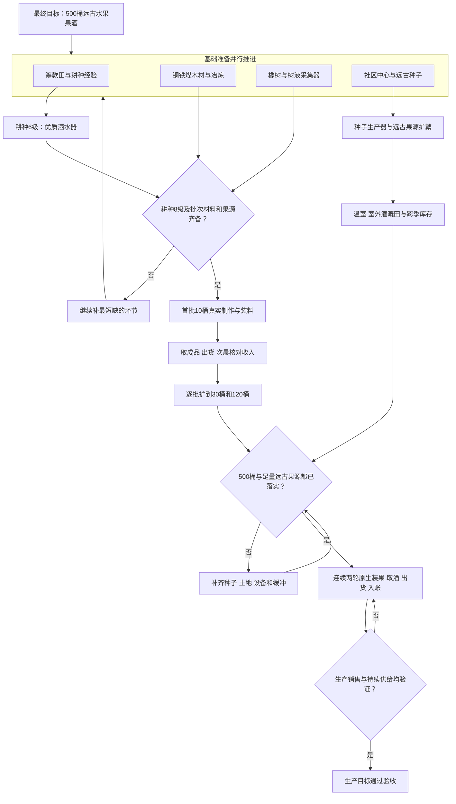
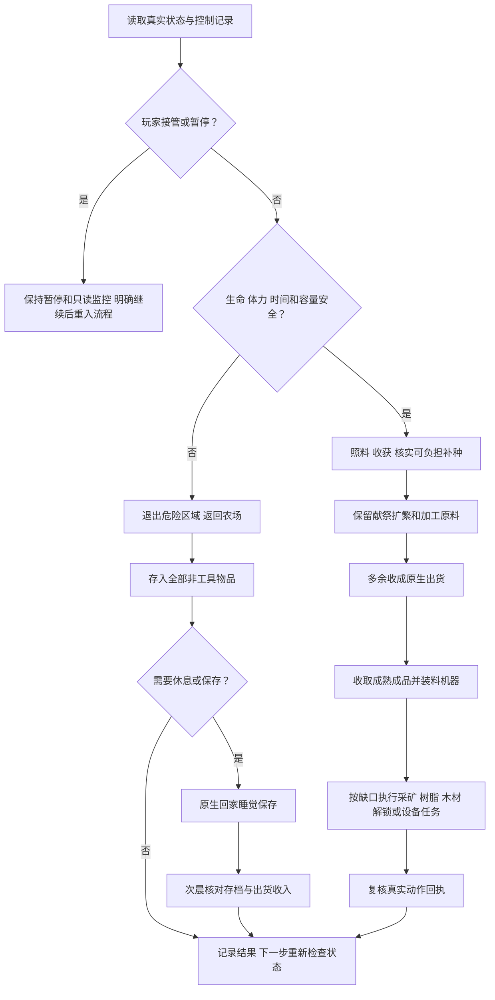
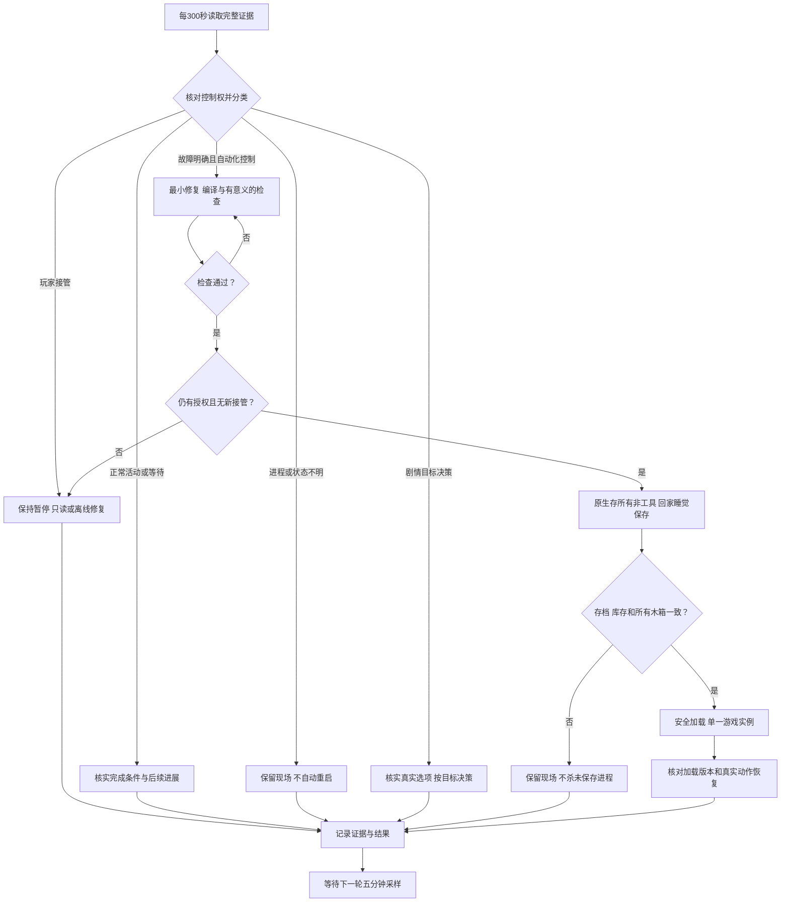

# 星露谷远古水果果酒自动化方案

方案版本日期：2026年10月13日。状态快照：北京时间11:48，游戏第1年秋季16日。本地控制器版本：20261013.38。

当前采用社区中心路线，以原生日常农务筹款和获取经验，同时准备金属、木材、树脂及远古果源。生产按10桶、30桶、120桶、500桶分批扩大。五分钟监控负责区分正常等待、故障和人工接管，并在授权边界内实施安全修复。

**当前仍处于基础准备阶段：酿酒桶0个，远古植物0株，温室未解锁。** 已积累71株作物、6个树液采集器和部分材料。季节水果可为前期加工提供周转，最终验收必须落实远古水果果酒。

## 目录

- [1 目标与验收](#1-目标与验收)
- [2 当前状态和资金去向](#2-当前状态和资金去向)
- [3 系统分层与职责](#3-系统分层与职责)
- [4 分阶段生产路线](#4-分阶段生产路线)
- [5 原料和连续供给](#5-原料和连续供给)
- [6 日常执行流程](#6-日常执行流程)
- [7 五分钟监控与安全修复](#7-五分钟监控与安全修复)
- [8 已验证能力与待完成工作](#8-已验证能力与待完成工作)
- [9 当前推进重点](#9-当前推进重点)
- [10 维护入口与证据来源](#10-维护入口与证据来源)

## 1 目标与验收

### 1.1 生产目标

| 层级 | 目标 | 完成条件 |
| --- | --- | --- |
| 启动批次 | 10桶、30桶 | 材料和真实果源齐备，原生制作、放置、装料及销售 |
| 第一规模目标 | 120桶 | 实际可达设备、配套果源和真实加工销售 |
| 最终规模目标 | 500桶远古水果果酒 | 配套远古果源、灌溉、储运、跨季缓冲和持续销售 |
| 最终运行验收 | 连续两轮 | 两轮原生装料、取酒、出货、次晨入账均有证据 |

空桶数量、制作计划、未来收获预测和腌菜收入不能单独满足最终验收。此前沟通中的“啤酒”沿用已澄清的远古水果果酒路线。

### 1.2 持续维护目标

每五分钟读取真实状态和证据。自动化拥有控制且故障明确时，诊断、修改、编译、检查，并通过原生存箱、睡觉保存和安全加载恢复。玩家接管后的暂停持续有效，恢复必须有更新的明确授权。

### 1.3 固定边界

- 运行无需外部模型API的本地流程；不启用AgentLab或Computer Use。
- 保留社区中心献祭路线，不加入Joja。
- 不修改存档创造物品、金钱、体力、经验、时间或解锁。
- 不擅自出售工具升级矿料。
- 保持原生品质、兼容堆叠和容量规则；每次返回存入全部非工具物品。
- 扩箱使用真实材料，设备和箱子避开入口与通路。
- 原生生命、体力和时间安全检查持续生效。

## 2 当前状态和资金去向

### 2.1 状态快照

以下是固定时点的观测值，运行中的游戏会继续变化。

| 类别 | 观测值 | 含义 |
| --- | --- | --- |
| 日期和现金 | 第1年秋季16日，1428g | 尚处于再投资和筹款阶段 |
| 活作物 | 71株 | 35株南瓜尚未成熟 |
| 耕种 | 5级，2634经验 | 到6级差666经验；到酿酒桶8级门槛差4266经验 |
| 矿井 | 最深8层 | 铁矿供应尚未建立 |
| 橡树 | 49棵，其中27棵成熟 | 可继续扩树脂供给，须保持原生可达性 |
| 树液采集器 | 6个 | 初期目标8个，后续16个和48个 |
| 酿酒桶和在制酒 | 0个，0份 | 尚未开始果酒产线 |
| 木材 | 1448 | 后续设备和建设仍有大量需求 |
| 铜料 | 31铜矿、1铜锭 | 正在采集与冶炼 |
| 铁料 | 0铁矿、0铁锭 | 当前关键材料缺口 |
| 煤和树脂 | 12煤、8橡树树脂 | 需要持续补充 |
| 一般果源 | 12份蔓越莓 | 可作前期周转，不能代表远古果源 |
| 温室和远古植物 | 未解锁，0株 | 最终供给链尚未建立 |
| 最终果酒验收 | 0/2轮 | 当前没有可计入最终验收的销售轮次 |
| 当前控制 | 玩家接回控制 | 文档发布不触发游戏恢复 |

主田为9×9启动方田，共81格，当前有2个稻草人和围栏通路，尚无洒水器。实际可种数量还受设备占格、每日浇水体力和已有作物影响。

### 2.2 之前几千金币的去向

秋季7日现金为6225g，原生购种支出如下。

| 购买内容 | 数量 | 支出 |
| --- | ---: | ---: |
| 南瓜种子 | 35 | 3500g |
| 蔓越莓种子 | 6 | 1440g |
| 玉米、茄子、山药和小麦种子 | 合计22 | 840g |
| 合计 | 63 | **5780g** |

购种后余额为445g。后续继续收获和补种；秋季15日清晨725g，购买16份茄子种子花320g，剩405g；次晨实际出货收入1023g，余额回到1428g。南瓜投入尚未回款。

### 2.3 当前资金策略

当前酒线优先推进耕种配方门槛和生产准备，同时保留至少300g基本周转金。因此现金会随购种下降，再随原生出货回升。“现金目标10000g”不等于已经保留10000g不可花费余额。

购种以实际商店报价、库存、剩余季节、已种作物和当日体力为输入。升级效率工具还需保护下一轮种子资金及实际所需矿锭；较大建设与养殖另有资金门槛。

扩大种植会占用资金和每日浇水时间。评估进度时应同时看实际现金、活作物、经验、材料、设备和已到账收入。预测利润与尚未入账的出货款分别记录。

## 3 系统分层与职责

| 层级 | 组件 | 职责 |
| --- | --- | --- |
| 原生游戏层 | Stardew Valley及真实存档 | 提供时间、掉落、配方、商店、种植、加工、出货和保存结果 |
| 本地执行层 | SMAPI与Together本地控制器 | 农务、移动、采矿、原生交易、制作、机器装料和睡觉 |
| 规划规则层 | 酒线、升级、存箱策略及种植计算器 | 根据实际资源、季节和安全预算选择下一步 |
| 证据采样层 | 独立只读采样器 | 每300秒读取状态、日志、库存、机器和存档，记录快照与分类 |
| 维护决策层 | Codex检查与修复 | 审查新故障，离线修改和检查，按授权执行安全更新 |
| 用户控制层 | 实际键鼠操作、暂停、明确继续 | 优先于自动化；新的接管立即改变恢复许可 |

并行准备指在日常任务中交错推进多个资源链。冶炼和树脂原生计时期间，可以安排农务或采矿；角色每次仍只执行实际可完成的动作。

## 4 分阶段生产路线

### 4.1 总体流程图

[独立流程图源文件](diagrams/production-roadmap.mmd) · [查看SVG图](diagrams/production-roadmap.svg)

### 4.2 阶段与门槛

| 阶段 | 进入条件 | 主要工作 | 当前状态 |
| --- | --- | --- | --- |
| A 基础准备 | 已有工具和可照料农田 | 每日农务；推进矿井；采木和冶炼；采集器8→16→48 | 正在执行 |
| B 降低日常劳动 | 耕种6级及真实铁、金、石英 | 原生制作并布局洒水器；按资金和余料升级工具 | 门槛未达到 |
| C 首批加工周转 | 耕种8级、完整批次材料及配套果源 | 10→30→120桶；实际装料、取成品和销售 | 尚未开始 |
| D 远古果源扩繁 | 真实远古种子或文物奖励；种子生产器实际解锁 | 保护种子和首批果实；并行扩繁；完成社区中心缺项 | 尚未建立 |
| E 持续500桶 | 足量远古果源、灌溉土地、储运和季节缓冲 | 扩大设备和田块；补齐冬季与次春供给；验证连续两轮 | 尚未达到 |

耕种经验门槛按当前控制器规则为6级3300、8级6900、9级10000。种子生产器和温室相关执行分支需要实际配方与解锁后才能放行。

### 4.3 当前关键路径

第一批加工受**配方、铜铁锭、木材、树脂及真实果源中最晚齐备的环节**限制。扩大到500桶还受远古种子扩繁、土地、灌溉和跨季供给限制。

现阶段的明显缺口是耕种经验、铁矿层推进和远古果源。资金投入与收成窗口会影响速度；随机种子获取和社区中心季节缺项也会改变完成时间，当前不承诺固定完工日期。

## 5 原料和连续供给

### 5.1 设备材料

酿酒桶配方需要耕种8级，每桶消耗30木材、1铜锭、1铁锭和1橡树树脂。[配方说明](https://wiki.stardewvalley.net/Keg)

| 规模 | 木材 | 铜锭 | 铁锭 | 橡树树脂 |
| --- | ---: | ---: | ---: | ---: |
| 10桶 | 300 | 10 | 10 | 10 |
| 30桶 | 900 | 30 | 30 | 30 |
| 120桶 | 3600 | 120 | 120 | 120 |
| 500桶 | 15000 | 500 | 500 | 500 |

表格只计算酿酒桶本身。采集器、熔炉、洒水器、种子生产器、箱子和建筑另计。已持有成品、已安装设备和已有材料需分别核对，避免重复准备已消耗过的材料。

当前从6个采集器补到48个，还需制作42个；按本地原生配方预算，额外需要1680木材和84铜锭。因此“500桶加剩余采集器”的设备需求为16680木材、584铜锭、500铁锭和500树脂，**这是扣除已有设备后的材料需求总额，尚未扣除现存材料，也未包含其他设施**。

### 5.2 果源预算

远古水果通常28天首熟、之后每7天再收获；室外生长季为春夏秋。果酒加工约6.25天，因此方案按每7天周转一轮安排采收和装料，最终仍以实际机器计时为准。[远古水果](https://wiki.stardewvalley.net/Ancient_Fruit) · [加工时间](https://wiki.stardewvalley.net/Keg)

| 运行规模 | 每轮所需远古水果 | 仅两轮装料所需 |
| --- | ---: | ---: |
| 120桶 | 120份 | 240份 |
| 500桶 | 500份 | 1000份 |

两轮库存只能证明两轮装料能力，持续供给还需未来真实收获与断产期缓冲。

温室只是育种和全年供给的一部分，不能独自支撑500桶。室外还需更多灌溉田，冬季及次春首熟前需要已有库存；姜岛全年种植只能在真实解锁后评估。

**规划示例，尚未执行：** 若每年安排16轮、每轮500份，则全年需要8000份水果。假设温室实际种116株、每株每年收16次，产量为1856份；室外每株当年收8次时，剩余6144份对应至少768株室外植物。该计算假定稳定灌溉、无损失、固定种植日期且不使用生长肥料，不能作为实收或现有产能。

### 5.3 保留与扩繁

1. 先按真实缺项保留社区中心献祭材料。
2. 获取远古种子后，保留扩繁所需种子和首批果实。
3. 只在原生允许、能完成成熟周期的地点和季节播种。
4. 种子生产器按实际投入与产出扩繁；随机结果不承诺获取日期。[设备说明](https://wiki.stardewvalley.net/Seed_Maker)
5. 一般季节水果可用于前期周转，最终远古果酒验收单独记录。

状态中的 `supported_kegs` 是根据一般果源、在制酒和7/14日条件收成计算的规划指标。当前值6不能解释为已有6桶，更不能解释为已有6桶远古果酒供给。

## 6 日常执行流程

### 6.1 每日决策顺序

安全检查贯穿所有动作。通常先照料并收获已有作物，保留献祭、扩繁和加工原料，出货多余收成；处理成熟机器并补料，再根据真实缺口安排设备、树脂、木材、采矿或解锁任务。

任务会根据位置、菜单和已有作业续接调整顺序。商店未营业、机器加工中、树脂未成熟时，核实完成条件，并安排可执行的其他任务。

### 6.2 日常流程图

[独立流程图源文件](diagrams/daily-operation.mmd) · [查看SVG图](diagrams/daily-operation.svg)

### 6.3 农田和采矿规则

| 环节 | 执行规则 |
| --- | --- |
| 农田布局 | 以NxN方田为主；优先补洞；围栏在耕作区外，门保持可通行，稻草人核验全部拟种区域 |
| 补种 | 使用真实种子；核对剩余季节、合法空地和实际体力；保留已有活作物 |
| 浇水 | 水壶可原生补水；自动灌溉未完成前，扩种受每日手工劳动限制 |
| 采矿选择 | 矿石、全部宝石、煤和晶球等资源优先；普通石头仅为必要通路或寻找原生楼梯按需敲 |
| 容量判断 | 检查所有兼容堆叠和品质；无空格时继续已有可堆叠品种，换批次前存箱 |
| 存箱 | 每次返回存入全部非工具物品；睡觉前再次核验 |
| 生命和体力 | 当前矿井生命门槛65；低体力约35时撤退并按安全规则睡觉 |
| 时间 | 采矿与回程预留实际时间；原生夜间安全边界保持 |

当前酒线配置保留70点采矿体力预算，升级策略文件仍含100点预算及70格目标等历史字段。当前模式实际容量按酒线、浇水能力、设备和方田重算，快照中的手工布局上限为81格；不能将历史字段直接当成当前全部有效规则。

## 7 五分钟监控与安全修复

### 7.1 采样与分类

独立采样器按300秒周期运行，记录完整快照和连续时间；它只读取游戏、存档和策略，只写项目监控日志。维护检查负责审查新问题和按授权实施修复。

| 观察情况 | 分类与处理 |
| --- | --- |
| 行走、冶炼、加工、等待开店 | 核实原因、完成条件和后续变化，保持正常执行 |
| 原生过夜或已保存更新清晨 | 核对存档和日期，保持合法检查点 |
| 更新的玩家键鼠或暂停记录 | 保持玩家控制；只读诊断和离线修复可做 |
| 故障证据明确，自动化仍拥有控制 | 定位源码，最小修改，编译和有意义的检查 |
| 进程缺失或状态陈旧 | 保留现场并复核；本身不授权重启 |
| 只有一张静止快照 | 间隔再次观察，不能直接判定卡死 |
| 剧情需要目标决策 | 根据实际选项、成本、奖励和长期目标选择；保留社区中心等约束 |

恢复授权根据最后一次真实开始来源和后来出现的人工接管记录判断。新的原生F6可以构成明确继续证据；仅有 `running=true` 或旧的“继续”不能覆盖更晚的接管。

### 7.2 监控与安全恢复流程图

[独立流程图源文件](diagrams/monitor-and-recovery.mmd) · [查看SVG图](diagrams/monitor-and-recovery.svg)

### 7.3 安全更新步骤

1. 根据明确故障完成最小源码修复，使用项目内.NET运行时编译并执行适合变更的检查。
2. 加载前重新核对控制权；若玩家已接管，等待新的明确继续。
3. 在允许恢复时，通过 `start-local.ps1 -Action save` 原生存入全部非工具物品、回家睡觉并保存。
4. 可采用已经核实的 `update_ready` 已保存清晨；普通清晨快照不能自动替代这个条件。
5. 使用 `update-local.ps1` 安全核对存档日期、库存和所有木箱，再安装并加载。
6. 验证加载版本和实际动作回执，确认运行恢复。

编译失败不安装；无法安全保存就保留现场，不杀未保存进程，也不强行加载。更新只复用或重建唯一游戏实例。完成编译、设置监控或暂时停工均不构成生产目标完成。

### 7.4 通知和终止条件

正常或重复状态保持安静，只在重要进展、确认修复、无法恢复的故障、必要用户操作或完成时通知。

生产目标全部通过验收后，按约定标记生产目标完成并暂停对应检查自动化。持续维护目标的状态仍须与用户最新要求一致，不能因为监控配置成功而提前结束。

## 8 已验证能力与待完成工作

| 能力 | 当前验证程度 |
| --- | --- |
| 本地日常农务、购种、收获、出货、冶炼和采集器制作 | 有原生动作回执 |
| 启动方田、围栏、门和稻草人覆盖 | 已有实机验证，后续规模需另验 |
| 低生命和低体力撤矿、存箱、睡觉保存 | 已观察完整流程，库存和次晨收入有证据 |
| 版本38的行走与家中出口修复 | 编译0错误0警告，805项检查通过；实机行走、存箱与过夜已观察 |
| 宠物通路预览 | 有代码检查；具体原生推宠物回执尚未观察 |
| 五分钟独立只读采样和分类 | 快照时已有14轮记录；分类检查11项及单实例检查通过 |
| 酿酒桶、种子生产器、灌溉和解锁分支 | 存在代码分支，后续门槛尚未满足，不能视为全链实机验证 |
| 120/500桶匹配远古供给 | 尚未建立 |
| 更大田块、跨季缓冲与姜岛相关分支 | 后续需按实际解锁规划、补齐实现并验证 |
| 整个画面黑屏或明暗闪烁 | 原因未确认；需显示路径对照，不能宣告修复 |

## 9 当前推进重点

| 优先项 | 下一项可核实结果 |
| --- | --- |
| 维护71株作物并保留成熟窗口 | 实际收获、耕种经验及次晨现金 |
| 达到耕种6级 | 剩余666经验归零，原生配方实际解锁 |
| 推进铁矿供应 | 真实矿层和铁矿/铁锭库存增长 |
| 初期采集器扩到8个 | 实际设备可达、原生安装和树脂成熟记录 |
| 准备首批10桶 | 8级配方、完整材料及可持续果源同时齐备 |
| 建立远古果源和温室路径 | 真实种子、播种、扩繁及献祭解锁证据 |
| 逐步扩大田地与设备 | 在120和500规模分别核验供给、通路、灌溉和储运 |

当前没有可信的完工日期。后续以真实采集率、成熟日期、解锁进度和加工回执更新估计。

## 10 维护入口与证据来源

### 10.1 本地文件索引

以下相对路径属于本地执行项目，便于维护者核对。

| 文件 | 用途 |
| --- | --- |
| `README.md` | 当前维护约束和操作说明，注意区分历史方案 |
| `logs/production-monitor-plan.json` | 监控目标、约束和验收要求 |
| `logs/resource-preparation-strategy.json` | 并行资源链、分批规模和后续缺口 |
| `logs/scale-acceptance-status.json` | 规模、果源和销售验收逐项状态 |
| `logs/production-monitor-state.json` | 最近检查与恢复证据 |
| `logs/production-sampler-runtime.json` | 采样周期、记录数和错误 |
| `logs/production-sampler-latest.json` | 最新完整采样快照 |
| `logs/production-sampler-history.jsonl` | 连续采样时间和真实进度 |
| `logs/native-recovery38-validation.json` | 版本38检查及原生运行证据 |
| `together/work/CompanionMods/Together/offline-status.json` | 实际运行状态 |
| `together/work/CompanionMods/Together/logs/` | 当前会话原生动作和交易回执 |
| `together/mod/Together/OfflineWineCampaign.cs` | 酒线阶段和任务调度 |
| `together/mod/Together/OfflineWinePreparation.cs` | 材料、一般果源和扩容门槛 |
| `monitor-local.ps1` | 独立只读采样 |
| `start-local.ps1` 与 `update-local.ps1` | 本地控制及原生保存安全更新 |

### 10.2 游戏机制与图表说明

- [酿酒桶配方与加工](https://wiki.stardewvalley.net/Keg)
- [远古水果生长与季节](https://wiki.stardewvalley.net/Ancient_Fruit)
- [种子生产器](https://wiki.stardewvalley.net/Seed_Maker)
- [GitHub Mermaid图表支持](https://docs.github.com/en/get-started/writing-on-github/working-with-advanced-formatting/creating-diagrams)
- [Together上游项目](https://github.com/Zsh123456-BOOP/stardew-together)

三个流程图同时保留内嵌Mermaid和独立源文件，便于在GitHub阅读和后续修改。
