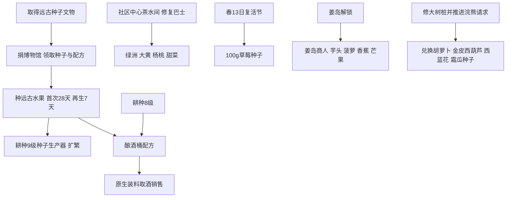

# 植物种植与价格全表

版本：1.6.15 build 24356。完整覆盖原生50条作物定义，并补充8种果树、11条野生树定义、茶树、牧草、混合种料和5种巨型作物。

## 阅读口径

金币购入价与种子卖出价分开。以下售价为单个产物、默认100%利润率、无职业加成的基础价；品质价向下取整。实际收益还要扣种子、肥料、补给及劳动成本。首次天数是播种后按时浇水的自然生长天数，不含催熟或职业加速；当天播种不算一天。连续收获作物只买一次种子；单收作物收获后需要重播。

温室和姜岛通常绕过季节限制，但不绕过种子获取、位置和任务条件。银/金/铱售价不代表普通田地一定能产出该品质；最高品质限制已知为0的作物显示“—”。四季野生种子产物随机，不能把原生占位产物当唯一收获。

## 一 普通作物与四季野生种子

### 春季可生长

同一多季作物会出现在多个季节表中；唯一作物定义总数仍为50。表按原生季节字段分类，仍须满足位置规则：仙人掌只能在温室、室内花盆或姜岛种植，不能据此在普通农场露天种植。

| 植物 | 种子ID | 种价与渠道 | 首次天数 | 再生天数 | 产物普通价 | 单次基础产量 |
| --- | --- | --- | --- | --- | --- | --- |
| 防风草 | (O)472 | 皮埃尔 20g | 4 | — | 防风草 35g | 1—1 |
| 青豆 | (O)473 | 皮埃尔 60g | 10 | 3 | 青豆 40g | 1—1 |
| 花椰菜 | (O)474 | 皮埃尔 80g | 12 | — | 花椰菜 175g | 1—1 |
| 土豆 | (O)475 | 皮埃尔 50g | 6 | — | 土豆 80g | 1—1＋随机额外产物 |
| 蒜 | (O)476 | 皮埃尔 40g | 4 | — | 蒜 60g | 1—1 |
| 未碾米 | (O)273 | 皮埃尔 40g | 8 | — | 未碾米 30g | 1—1＋随机额外产物 |
| 甘蓝菜 | (O)477 | 皮埃尔 70g | 6 | — | 甘蓝菜 110g | 1—1 |
| 大黄 | (O)478 | 绿洲 100g | 13 | — | 大黄 220g | 1—1 |
| 草莓 | (O)745 | 复活节皮埃尔 100g | 8 | 4 | 草莓 120g | 1—1＋随机额外产物 |
| 咖啡豆 | (O)433 | 旅行货车 2500g | 10 | 2 | 咖啡豆 15g | 4—4＋随机额外产物 |
| 仙人掌果子 | (O)802 | 绿洲 150g | 12 | 3 | 仙人掌果子 75g | 1—1 |
| 上古水果 | (O)499 | 无常规金币售价；制作、奖励或随机获得 | 28 | 7 | 上古水果 550g | 1—1 |
| 郁金香 | (O)427 | 皮埃尔 20g | 6 | — | 郁金香 30g | 1—1 |
| 蓝爵 | (O)429 | 皮埃尔 30g | 7 | — | 蓝爵 50g | 1—1 |
| 野山葵、黄水仙、韭葱、蒲公英 | (O)495 | 无常规金币售价；制作、奖励或随机获得 | 7 | — | 野山葵 50g；黄水仙 30g；韭葱 60g；蒲公英 40g | 1—1 |
| 纤维 | (O)885 | 无常规金币售价；制作、奖励或随机获得 | 7 | — | 纤维 1g | 4—7＋随机额外产物 |
| 齐瓜 | (O)890 | 无常规金币售价；制作、奖励或随机获得 | 4 | — | 齐瓜 1g | 1—1 |
| 胡萝卜 | (O)CarrotSeeds | 浣熊妻子 枫树种子 ×1 | 3 | — | 胡萝卜 35g | 1—1 |

### 夏季可生长

同一多季作物会出现在多个季节表中；唯一作物定义总数仍为50。表按原生季节字段分类，仍须满足位置规则：仙人掌只能在温室、室内花盆或姜岛种植，不能据此在普通农场露天种植。

| 植物 | 种子ID | 种价与渠道 | 首次天数 | 再生天数 | 产物普通价 | 单次基础产量 |
| --- | --- | --- | --- | --- | --- | --- |
| 芋头 | (O)831 | 姜岛商人 骨头碎片 ×2 | 10 | — | 芋头 100g | 1—1 |
| 甜瓜 | (O)479 | 皮埃尔 80g | 12 | — | 甜瓜 250g | 1—1 |
| 西红柿 | (O)480 | 皮埃尔 50g | 11 | 4 | 西红柿 60g | 1—1＋随机额外产物 |
| 蓝莓 | (O)481 | 皮埃尔 80g | 13 | 4 | 蓝莓 50g | 3—3＋随机额外产物 |
| 辣椒 | (O)482 | 皮埃尔 40g | 5 | 3 | 辣椒 40g | 1—1＋随机额外产物 |
| 小麦 | (O)483 | 皮埃尔 10g | 4 | — | 小麦 25g | 1—1 |
| 萝卜 | (O)484 | 皮埃尔 40g | 6 | — | 萝卜 90g | 1—1 |
| 红叶卷心菜 | (O)485 | 皮埃尔 100g；旅行货车 动态报价（按条件/随机价格规则计算；不将基准字段当成交价） | 9 | — | 红叶卷心菜 260g | 1—1 |
| 杨桃 | (O)486 | 绿洲 400g | 13 | — | 杨桃 750g | 1—1 |
| 菠萝 | (O)833 | 姜岛商人 熔岩菇 ×1 | 14 | 7 | 菠萝 300g | 1—1 |
| 咖啡豆 | (O)433 | 旅行货车 2500g | 10 | 2 | 咖啡豆 15g | 4—4＋随机额外产物 |
| 仙人掌果子 | (O)802 | 绿洲 150g | 12 | 3 | 仙人掌果子 75g | 1—1 |
| 玉米 | (O)487 | 皮埃尔 150g | 14 | 4 | 玉米 50g | 1—1 |
| 啤酒花 | (O)302 | 皮埃尔 60g | 11 | 1 | 啤酒花 25g | 1—1 |
| 上古水果 | (O)499 | 无常规金币售价；制作、奖励或随机获得 | 28 | 7 | 上古水果 550g | 1—1 |
| 虞美人花 | (O)453 | 皮埃尔 100g | 7 | — | 虞美人花 140g | 1—1 |
| 夏季亮片 | (O)455 | 皮埃尔 50g | 8 | — | 夏季亮片 90g | 1—1 |
| 向日葵 | (O)431 | 皮埃尔 200g | 8 | — | 向日葵 80g | 1—1 |
| 香味浆果、葡萄、甜豌豆 | (O)496 | 无常规金币售价；制作、奖励或随机获得 | 7 | — | 香味浆果 80g；葡萄 80g；甜豌豆 50g | 1—1 |
| 纤维 | (O)885 | 无常规金币售价；制作、奖励或随机获得 | 7 | — | 纤维 1g | 4—7＋随机额外产物 |
| 齐瓜 | (O)890 | 无常规金币售价；制作、奖励或随机获得 | 4 | — | 齐瓜 1g | 1—1 |
| 金皮西葫芦 | (O)SummerSquashSeeds | 浣熊妻子 树液 ×15 | 6 | 3 | 金皮西葫芦 45g | 1—1 |

### 秋季可生长

同一多季作物会出现在多个季节表中；唯一作物定义总数仍为50。表按原生季节字段分类，仍须满足位置规则：仙人掌只能在温室、室内花盆或姜岛种植，不能据此在普通农场露天种植。

| 植物 | 种子ID | 种价与渠道 | 首次天数 | 再生天数 | 产物普通价 | 单次基础产量 |
| --- | --- | --- | --- | --- | --- | --- |
| 小麦 | (O)483 | 皮埃尔 10g | 4 | — | 小麦 25g | 1—1 |
| 仙人掌果子 | (O)802 | 绿洲 150g | 12 | 3 | 仙人掌果子 75g | 1—1 |
| 玉米 | (O)487 | 皮埃尔 150g | 14 | 4 | 玉米 50g | 1—1 |
| 葡萄 | (O)301 | 皮埃尔 60g | 10 | 3 | 葡萄 80g | 1—1 |
| 苋菜 | (O)299 | 皮埃尔 70g | 7 | — | 苋菜 150g | 1—1 |
| 茄子 | (O)488 | 皮埃尔 20g | 5 | 5 | 茄子 60g | 1—1＋随机额外产物 |
| 洋蓟 | (O)489 | 皮埃尔 30g | 8 | — | 洋蓟 160g | 1—1 |
| 南瓜 | (O)490 | 皮埃尔 100g | 13 | — | 南瓜 320g | 1—1 |
| 小白菜 | (O)491 | 皮埃尔 50g | 4 | — | 小白菜 80g | 1—1 |
| 山药 | (O)492 | 皮埃尔 60g | 10 | — | 山药 160g | 1—1 |
| 蔓越莓 | (O)493 | 皮埃尔 240g | 7 | 5 | 蔓越莓 75g | 2—2＋随机额外产物 |
| 甜菜 | (O)494 | 绿洲 20g | 6 | — | 甜菜 100g | 1—1 |
| 上古水果 | (O)499 | 无常规金币售价；制作、奖励或随机获得 | 28 | 7 | 上古水果 550g | 1—1 |
| 向日葵 | (O)431 | 皮埃尔 200g | 8 | — | 向日葵 80g | 1—1 |
| 玫瑰仙子 | (O)425 | 皮埃尔 200g | 12 | — | 玫瑰仙子 290g | 1—1 |
| 宝石甜莓 | (O)347 | 旅行货车 1000g | 24 | — | 宝石甜莓 3000g | 1—1 |
| 普通蘑菇、野梅、榛子、黑莓 | (O)497 | 无常规金币售价；制作、奖励或随机获得 | 7 | — | 普通蘑菇 40g；野梅 80g；榛子 90g；黑莓 20g | 1—1 |
| 纤维 | (O)885 | 无常规金币售价；制作、奖励或随机获得 | 7 | — | 纤维 1g | 4—7＋随机额外产物 |
| 齐瓜 | (O)890 | 无常规金币售价；制作、奖励或随机获得 | 4 | — | 齐瓜 1g | 1—1 |
| 西蓝花 | (O)BroccoliSeeds | 浣熊妻子 苔藓 ×5 | 8 | 4 | 西蓝花 70g | 1—1 |

### 冬季可生长

同一多季作物会出现在多个季节表中；唯一作物定义总数仍为50。表按原生季节字段分类，仍须满足位置规则：仙人掌只能在温室、室内花盆或姜岛种植，不能据此在普通农场露天种植。

| 植物 | 种子ID | 种价与渠道 | 首次天数 | 再生天数 | 产物普通价 | 单次基础产量 |
| --- | --- | --- | --- | --- | --- | --- |
| 仙人掌果子 | (O)802 | 绿洲 150g | 12 | 3 | 仙人掌果子 75g | 1—1 |
| 冬根、水晶果、雪山药、番红花 | (O)498 | 无常规金币售价；制作、奖励或随机获得 | 7 | — | 冬根 70g；水晶果 150g；雪山药 100g；番红花 60g | 1—1 |
| 纤维 | (O)885 | 无常规金币售价；制作、奖励或随机获得 | 7 | — | 纤维 1g | 4—7＋随机额外产物 |
| 齐瓜 | (O)890 | 无常规金币售价；制作、奖励或随机获得 | 4 | — | 齐瓜 1g | 1—1 |
| 霜瓜 | (O)PowdermelonSeeds | 浣熊妻子 松果 ×2 | 7 | — | 霜瓜 60g | 1—1 |

### 所有50条作物的品质售价

| 植物 | 产物 | 普通g | 银星g | 金星g | 铱星g |
| --- | --- | --- | --- | --- | --- |
| 防风草 | 防风草 | 35 | 43 | 52 | 70 |
| 青豆 | 青豆 | 40 | 50 | 60 | 80 |
| 花椰菜 | 花椰菜 | 175 | 218 | 262 | 350 |
| 土豆 | 土豆 | 80 | 100 | 120 | 160 |
| 蒜 | 蒜 | 60 | 75 | 90 | 120 |
| 未碾米 | 未碾米 | 30 | 37 | 45 | 60 |
| 芋头 | 芋头 | 100 | 125 | 150 | 200 |
| 甘蓝菜 | 甘蓝菜 | 110 | 137 | 165 | 220 |
| 大黄 | 大黄 | 220 | 275 | 330 | 440 |
| 草莓 | 草莓 | 120 | 150 | 180 | 240 |
| 甜瓜 | 甜瓜 | 250 | 312 | 375 | 500 |
| 西红柿 | 西红柿 | 60 | 75 | 90 | 120 |
| 蓝莓 | 蓝莓 | 50 | 62 | 75 | 100 |
| 辣椒 | 辣椒 | 40 | 50 | 60 | 80 |
| 小麦 | 小麦 | 25 | 31 | 37 | 50 |
| 萝卜 | 萝卜 | 90 | 112 | 135 | 180 |
| 红叶卷心菜 | 红叶卷心菜 | 260 | 325 | 390 | 520 |
| 杨桃 | 杨桃 | 750 | 937 | 1125 | 1500 |
| 菠萝 | 菠萝 | 300 | 375 | 450 | 600 |
| 咖啡豆 | 咖啡豆 | 15 | 18 | 22 | 30 |
| 仙人掌果子 | 仙人掌果子 | 75 | 93 | 112 | 150 |
| 玉米 | 玉米 | 50 | 62 | 75 | 100 |
| 啤酒花 | 啤酒花 | 25 | 31 | 37 | 50 |
| 葡萄 | 葡萄 | 80 | 100 | 120 | 160 |
| 苋菜 | 苋菜 | 150 | 187 | 225 | 300 |
| 茄子 | 茄子 | 60 | 75 | 90 | 120 |
| 洋蓟 | 洋蓟 | 160 | 200 | 240 | 320 |
| 南瓜 | 南瓜 | 320 | 400 | 480 | 640 |
| 小白菜 | 小白菜 | 80 | 100 | 120 | 160 |
| 山药 | 山药 | 160 | 200 | 240 | 320 |
| 蔓越莓 | 蔓越莓 | 75 | 93 | 112 | 150 |
| 甜菜 | 甜菜 | 100 | 125 | 150 | 200 |
| 上古水果 | 上古水果 | 550 | 687 | 825 | 1100 |
| 郁金香 | 郁金香 | 30 | 37 | 45 | 60 |
| 蓝爵 | 蓝爵 | 50 | 62 | 75 | 100 |
| 虞美人花 | 虞美人花 | 140 | 175 | 210 | 280 |
| 夏季亮片 | 夏季亮片 | 90 | 112 | 135 | 180 |
| 向日葵 | 向日葵 | 80 | 100 | 120 | 160 |
| 玫瑰仙子 | 玫瑰仙子 | 290 | 362 | 435 | 580 |
| 宝石甜莓 | 宝石甜莓 | 3000 | 3750 | 4500 | 6000 |
| 野山葵、黄水仙、韭葱、蒲公英 | 野山葵 | 50 | 62 | 75 | 100 |
| 野山葵、黄水仙、韭葱、蒲公英 | 黄水仙 | 30 | 37 | 45 | 60 |
| 野山葵、黄水仙、韭葱、蒲公英 | 韭葱 | 60 | 75 | 90 | 120 |
| 野山葵、黄水仙、韭葱、蒲公英 | 蒲公英 | 40 | 50 | 60 | 80 |
| 香味浆果、葡萄、甜豌豆 | 香味浆果 | 80 | 100 | 120 | 160 |
| 香味浆果、葡萄、甜豌豆 | 葡萄 | 80 | 100 | 120 | 160 |
| 香味浆果、葡萄、甜豌豆 | 甜豌豆 | 50 | 62 | 75 | 100 |
| 普通蘑菇、野梅、榛子、黑莓 | 普通蘑菇 | 40 | 50 | 60 | 80 |
| 普通蘑菇、野梅、榛子、黑莓 | 野梅 | 80 | 100 | 120 | 160 |
| 普通蘑菇、野梅、榛子、黑莓 | 榛子 | 90 | 112 | 135 | 180 |
| 普通蘑菇、野梅、榛子、黑莓 | 黑莓 | 20 | 25 | 30 | 40 |
| 冬根、水晶果、雪山药、番红花 | 冬根 | 70 | 87 | 105 | 140 |
| 冬根、水晶果、雪山药、番红花 | 水晶果 | 150 | 187 | 225 | 300 |
| 冬根、水晶果、雪山药、番红花 | 雪山药 | 100 | 125 | 150 | 200 |
| 冬根、水晶果、雪山药、番红花 | 番红花 | 60 | 75 | 90 | 120 |
| 纤维 | 纤维 | 1 | — | — | — |
| 齐瓜 | 齐瓜 | 1 | — | — | — |
| 胡萝卜 | 胡萝卜 | 35 | 43 | 52 | 70 |
| 金皮西葫芦 | 金皮西葫芦 | 45 | 56 | 67 | 90 |
| 西蓝花 | 西蓝花 | 70 | 87 | 105 | 140 |
| 霜瓜 | 霜瓜 | 60 | 75 | 90 | 120 |

### 所有50条作物的前导依赖

每条保留原生商店条件；YEAR 2是第2年起，SEASON是商店供货条件，不能与生长季节混淆。

| 种子 | 前导依赖与种植约束 | 来源 |
| --- | --- | --- |
| 防风草种子 | 当季皮埃尔供货；需要可耕田、实际种子与浇水能力。 | [原生字段与专题](https://wiki.stardewvalley.net/Parsnip_Seeds) |
| 青豆种子 | 当季皮埃尔供货；需要可耕田、实际种子与浇水能力。 支架作物不可穿行，布局必须留通道。 | [原生字段与专题](https://wiki.stardewvalley.net/Bean_Starter) |
| 花椰菜种子 | 当季皮埃尔供货；需要可耕田、实际种子与浇水能力。 | [原生字段与专题](https://wiki.stardewvalley.net/Cauliflower_Seeds) |
| 土豆种子 | 当季皮埃尔供货；需要可耕田、实际种子与浇水能力。 | [原生字段与专题](https://wiki.stardewvalley.net/Potato_Seeds) |
| 大蒜种子 | 皮埃尔从第2年春季供货；随机来源不是第1年稳定供货。 | [原生字段与专题](https://wiki.stardewvalley.net/Garlic_Seeds) |
| 稻苗 | 皮埃尔从第2年春季供货；近水3格内可自动浇水，普通8天、稻田6天。 | [原生字段与专题](https://wiki.stardewvalley.net/Rice_Shoot) |
| 芋头块茎 | 姜岛商人用2骨头碎片换1芋头块茎；也有姜岛掉落。普通10天、近水稻田7天。 | [原生字段与专题](https://wiki.stardewvalley.net/Taro_Tuber) |
| 甘蓝种子 | 当季皮埃尔供货；需要可耕田、实际种子与浇水能力。 | [原生字段与专题](https://wiki.stardewvalley.net/Kale_Seeds) |
| 大黄种子 | 绿洲100g；先修复巴士。 | [原生字段与专题](https://wiki.stardewvalley.net/Rhubarb_Seeds) |
| 草莓种子 | 复活节春13日100g；沙漠节还可用彩蛋兑换。普通商店不出售；无催熟春13夜种通常只收两轮。 | [原生字段与专题](https://wiki.stardewvalley.net/Strawberry_Seeds) |
| 甜瓜种子 | 当季皮埃尔供货；需要可耕田、实际种子与浇水能力。 | [原生字段与专题](https://wiki.stardewvalley.net/Melon_Seeds) |
| 西红柿种子 | 当季皮埃尔供货；需要可耕田、实际种子与浇水能力。 | [原生字段与专题](https://wiki.stardewvalley.net/Tomato_Seeds) |
| 蓝莓种子 | 当季皮埃尔供货；需要可耕田、实际种子与浇水能力。 | [原生字段与专题](https://wiki.stardewvalley.net/Blueberry_Seeds) |
| 辣椒种子 | 当季皮埃尔供货；需要可耕田、实际种子与浇水能力。 | [原生字段与专题](https://wiki.stardewvalley.net/Pepper_Seeds) |
| 小麦种子 | 当季皮埃尔供货；需要可耕田、实际种子与浇水能力。 | [原生字段与专题](https://wiki.stardewvalley.net/Wheat_Seeds) |
| 萝卜种子 | 当季皮埃尔供货；需要可耕田、实际种子与浇水能力。 | [原生字段与专题](https://wiki.stardewvalley.net/Radish_Seeds) |
| 红叶卷心菜种子 | 稳定供货从第2年夏季开始；第1年旅行货车随机/保证设置不是常规商店解锁。 | [原生字段与专题](https://wiki.stardewvalley.net/Red_Cabbage_Seeds) |
| 杨桃种子 | 绿洲400g；先修复巴士。 | [原生字段与专题](https://wiki.stardewvalley.net/Starfruit_Seeds) |
| 菠萝种子 | 姜岛商人用1岩浆帽换1种子；也有姜岛掉落。 | [原生字段与专题](https://wiki.stardewvalley.net/Pineapple_Seeds) |
| 咖啡豆 | 种子就是咖啡豆本身；灰尘精灵掉落，旅行货车随机2500g或随机商品报价；每次至少4豆。 | [原生字段与专题](https://wiki.stardewvalley.net/Coffee_Bean) |
| 仙人掌种子 | 绿洲150g；需解锁沙漠。仅温室、室内花盆或姜岛可种；普通农场露天不能存活。 | [原生字段与专题](https://wiki.stardewvalley.net/Cactus_Seeds) |
| 玉米种子 | 当季皮埃尔供货；需要可耕田、实际种子与浇水能力。 | [原生字段与专题](https://wiki.stardewvalley.net/Corn_Seeds) |
| 啤酒花种子 | 当季皮埃尔供货；需要可耕田、实际种子与浇水能力。 支架作物不可穿行，布局必须留通道。 | [原生字段与专题](https://wiki.stardewvalley.net/Hops_Starter) |
| 葡萄种子 | 当季皮埃尔供货；需要可耕田、实际种子与浇水能力。 支架作物不可穿行，布局必须留通道。 | [原生字段与专题](https://wiki.stardewvalley.net/Grape_Starter) |
| 苋菜种子 | 当季皮埃尔供货；需要可耕田、实际种子与浇水能力。 | [原生字段与专题](https://wiki.stardewvalley.net/Amaranth_Seeds) |
| 茄子种子 | 当季皮埃尔供货；需要可耕田、实际种子与浇水能力。 | [原生字段与专题](https://wiki.stardewvalley.net/Eggplant_Seeds) |
| 洋蓟种子 | 皮埃尔从第2年秋季供货。 | [原生字段与专题](https://wiki.stardewvalley.net/Artichoke_Seeds) |
| 南瓜种子 | 当季皮埃尔供货；需要可耕田、实际种子与浇水能力。 | [原生字段与专题](https://wiki.stardewvalley.net/Pumpkin_Seeds) |
| 小白菜种子 | 当季皮埃尔供货；需要可耕田、实际种子与浇水能力。 | [原生字段与专题](https://wiki.stardewvalley.net/Bok_Choy_Seeds) |
| 山药种子 | 当季皮埃尔供货；需要可耕田、实际种子与浇水能力。 | [原生字段与专题](https://wiki.stardewvalley.net/Yam_Seeds) |
| 蔓越莓种子 | 当季皮埃尔供货；需要可耕田、实际种子与浇水能力。 | [原生字段与专题](https://wiki.stardewvalley.net/Cranberry_Seeds) |
| 甜菜种子 | 绿洲20g；先修复巴士。 | [原生字段与专题](https://wiki.stardewvalley.net/Beet_Seeds) |
| 上古种子 | 捐赠远古种子文物(114)给博物馆，领取可种种子(499)及制作配方；种子生产器可繁育。1.6.3起旅行货车不再出售；不能种花盆。 | [原生字段与专题](https://wiki.stardewvalley.net/Ancient_Seeds) |
| 郁金香球茎 | 当季皮埃尔供货；需要可耕田、实际种子与浇水能力。 | [原生字段与专题](https://wiki.stardewvalley.net/Tulip_Bulb) |
| 蓝爵士种子 | 当季皮埃尔供货；需要可耕田、实际种子与浇水能力。 | [原生字段与专题](https://wiki.stardewvalley.net/Jazz_Seeds) |
| 虞美人种子 | 当季皮埃尔供货；需要可耕田、实际种子与浇水能力。 | [原生字段与专题](https://wiki.stardewvalley.net/Poppy_Seeds) |
| 夏季亮片种子 | 当季皮埃尔供货；需要可耕田、实际种子与浇水能力。 | [原生字段与专题](https://wiki.stardewvalley.net/Spangle_Seeds) |
| 向日葵种子 | 当季皮埃尔供货；需要可耕田、实际种子与浇水能力。 | [原生字段与专题](https://wiki.stardewvalley.net/Sunflower_Seeds) |
| 玫瑰仙子种子 | 当季皮埃尔供货；需要可耕田、实际种子与浇水能力。 | [原生字段与专题](https://wiki.stardewvalley.net/Fairy_Seeds) |
| 稀有种子 | 旅行货车春夏固定栏目1000g、其他随机库存依报价；秋季种，需24天；甜宝石浆果不能酿酒。 | [原生字段与专题](https://wiki.stardewvalley.net/Rare_Seed) |
| 春季种子 | 采集1级配方；辣根、水仙花、韭葱、蒲公英各1制作10种子；春季随机采集作物。 | [原生字段与专题](https://wiki.stardewvalley.net/Spring_Seeds) |
| 夏季种子 | 采集4级配方；香豌豆、葡萄、香料浆果各1制作10种子；夏季随机采集作物。 | [原生字段与专题](https://wiki.stardewvalley.net/Summer_Seeds) |
| 秋季种子 | 采集6级配方；普通蘑菇、野梅、榛子、黑莓各1制作10种子；秋季随机采集作物。 | [原生字段与专题](https://wiki.stardewvalley.net/Fall_Seeds) |
| 冬季种子 | 采集7级配方；冬根、水晶果、雪山药、番红花各1制作10种子；冬季随机采集作物。 | [原生字段与专题](https://wiki.stardewvalley.net/Winter_Seeds) |
| 纤维种子 | 完成莱纳斯特别订单“社区清理”取得配方；混合种子、树液和黏土制作；无需浇水，可跨季。 | [原生字段与专题](https://wiki.stardewvalley.net/Fiber_Seeds) |
| 齐豆 | 需姜岛齐先生核桃房（100金核桃门槛）并接“齐先生的作物”订单；订单期间随机获得，期限后种子与齐瓜会被移除。 | [原生字段与专题](https://wiki.stardewvalley.net/Qi_Bean) |
| 胡萝卜种子 | 不能用金币常规买种；种子点等随机来源（通常冬21至春23）；浣熊商店1枫树种子兑换。 | [原生字段与专题](https://wiki.stardewvalley.net/Carrot_Seeds) |
| 金皮西葫芦种子 | 不能用金币常规买种；种子点等随机来源（通常春24至夏20）；浣熊商店15树液兑换。 | [原生字段与专题](https://wiki.stardewvalley.net/Summer_Squash_Seeds) |
| 西蓝花种子 | 不能用金币常规买种；种子点等随机来源（通常夏21至秋20）；浣熊商店5苔藓兑换。 | [原生字段与专题](https://wiki.stardewvalley.net/Broccoli_Seeds) |
| 霜瓜种子 | 不能用金币常规买种；种子点等随机来源（通常秋21至冬20）；浣熊商店2松果兑换。 | [原生字段与专题](https://wiki.stardewvalley.net/Powdermelon_Seeds) |

## 二 果树

果树成熟前的28天不等于从任意季节种下28天后必定有果实：露天还要等对应结果季。采果不消耗种子，成熟期通常每天1果，树上最多积3果。

| 果树 | 树苗 | 树苗价格 | 结果季 | 成熟天数 | 单果普通/银/金/铱g | 前导依赖 |
| --- | --- | --- | --- | --- | --- | --- |
| 樱桃 | 樱桃树苗 | 皮埃尔 3400g | 春 | 28 | 80/100/120/160 | 皮埃尔出售树苗；正常成熟需周围8格不阻塞。成熟28天，不需浇水；室外只在结果季产果，温室/姜岛全年；树龄或树苗品质影响果实品质。 |
| 杏子 | 杏子树苗 | 皮埃尔 2000g | 春 | 28 | 50/62/75/100 | 皮埃尔出售树苗；正常成熟需周围8格不阻塞。成熟28天，不需浇水；室外只在结果季产果，温室/姜岛全年；树龄或树苗品质影响果实品质。 |
| 橙子 | 橙子树苗 | 皮埃尔 4000g | 夏 | 28 | 100/125/150/200 | 皮埃尔出售树苗；正常成熟需周围8格不阻塞。成熟28天，不需浇水；室外只在结果季产果，温室/姜岛全年；树龄或树苗品质影响果实品质。 |
| 桃子 | 桃子树苗 | 皮埃尔 6000g | 夏 | 28 | 140/175/210/280 | 皮埃尔出售树苗；正常成熟需周围8格不阻塞。成熟28天，不需浇水；室外只在结果季产果，温室/姜岛全年；树龄或树苗品质影响果实品质。 |
| 石榴 | 石榴树苗 | 皮埃尔 6000g | 秋 | 28 | 140/175/210/280 | 皮埃尔出售树苗；正常成熟需周围8格不阻塞。成熟28天，不需浇水；室外只在结果季产果，温室/姜岛全年；树龄或树苗品质影响果实品质。 |
| 苹果 | 苹果树苗 | 皮埃尔 4000g | 秋 | 28 | 100/125/150/200 | 皮埃尔出售树苗；正常成熟需周围8格不阻塞。成熟28天，不需浇水；室外只在结果季产果，温室/姜岛全年；树龄或树苗品质影响果实品质。 |
| 香蕉 | 香蕉树苗 | 姜岛商人 龙牙 ×5 | 夏 | 28 | 150/187/225/300 | 姜岛获取：金色椰子/商人兑换；需姜岛解锁。成熟28天，不需浇水；室外只在结果季产果，温室/姜岛全年；树龄或树苗品质影响果实品质。 |
| 芒果 | 芒果幼苗 | 姜岛商人 蚌 ×75 | 夏 | 28 | 130/162/195/260 | 姜岛获取：金色椰子/商人兑换；需姜岛解锁。成熟28天，不需浇水；室外只在结果季产果，温室/姜岛全年；树龄或树苗品质影响果实品质。 |

## 三 野生树

野生树的生长是随机过程；表中生长概率对应满足空间等条件时每日推进阶段的原生参数，不是固定成熟天数。采集器计时受版本代码、季节和高级采集器影响，表中列Data/WildTrees的基础天数字段。

| 树种 | 种料 | 是否可种 | 种价/来源 | 每日生长概率 | 冬季自然生长 | 采集器产物与基础周期 | 前导依赖 |
| --- | --- | --- | --- | --- | --- | --- | --- |
| 橡树 | 橡子 | 是 | 无常规金币买种；掉落、制作或特殊解锁 | 0.2 | 否 | 橡树树脂 7天 150g | 种子掉落/摇树；成熟前需空间，生长按每日概率判定，不能承诺固定成熟天数。 |
| 枫树 | 枫树种子 | 是 | 无常规金币买种；掉落、制作或特殊解锁 | 0.2 | 否 | 枫糖浆 9天 200g | 种子掉落/摇树；成熟前需空间，生长按每日概率判定，不能承诺固定成熟天数。 |
| 松树 | 松果 | 是 | 无常规金币买种；掉落、制作或特殊解锁 | 0.2 | 否 | 松焦油 5天 100g | 种子掉落/摇树；成熟前需空间，生长按每日概率判定，不能承诺固定成熟天数。 |
| 蘑菇树 | 蘑菇树种子 | 是 | QiGemShop 齐钻 ×5 | 0.2 | 否 | 红蘑菇 1天 75g（有条件）；普通蘑菇 2天 40g（有条件）；红蘑菇 1天 75g（有条件）；紫蘑菇 2天 250g（有条件）；上次产物 1天 售价随产物（有条件）；普通蘑菇 2天 40g（有条件） | 秋季随机转化或齐先生商店购买蘑菇树种子；采集器产物取决于季节、日期和上次产物。 |
| 桃花心木 | 桃花心木种子 | 是 | 姜岛商人 黄貂鱼 ×1；浣熊妻子 煤炭 ×20 | 0.15 | 否 | 树液 1天 2g | 桃花心木种子来自树桩、秘密森林史莱姆等；主要产硬木。生长概率低于普通树。 |
| 棕榈树一型 | 椰子 | 否 | 绿洲 200g | 0.2 | 是 |  | 地图原生棕榈树，种子不能种植；无普通采集器产物。 |
| 棕榈树二型 | 椰子 | 否 | 绿洲 200g | 0.2 | 是 |  | 地图原生棕榈树，种子不能种植；无普通采集器产物。 |
| 绿雨树一型 | 长满苔藓的种子 | 是 | 无常规金币买种；掉落、制作或特殊解锁 | 0.2 | 否 |  | 绿雨事件或苔藓种子产生对应树形；不是每种树都有独立商品种子。 |
| 绿雨树二型 | 长满苔藓的种子 | 是 | 无常规金币买种；掉落、制作或特殊解锁 | 0.2 | 否 |  | 绿雨事件或苔藓种子产生对应树形；不是每种树都有独立商品种子。 |
| 绿雨树三型 | 长满苔藓的种子 | 是 | 无常规金币买种；掉落、制作或特殊解锁 | 0.2 | 否 | 蕨菜 2天 90g（有条件） | 绿雨事件或苔藓种子产生对应树形；不是每种树都有独立商品种子。 |
| 神秘树 | 神秘树种 | 是 | 无常规金币买种；掉落、制作或特殊解锁 | 0.15 | 否 | 神秘糖浆 7天 1000g | 采集精通解锁神秘树种子配方；5橡子、5枫树种子、5松果、5桃花心木种子；树肥可改善生长。 |

砍伐产物另按原生掉落：普通成年树通常掉木材12—16、树液等；桃花心木主要掉硬木10。木材基础卖价2g、硬木15g、树液2g；采集器产物与砍伐收益不能混算。
## 四 茶树 牧草和混合种料

| 植物 | 种料价格/取得 | 季节 | 周期 | 产物基础价 | 前导依赖 |
| --- | --- | --- | --- | --- | --- |
| 茶树 | 制作：季节野生种子2、纤维5、木材5；不当成常规金币商品 | 春、夏、秋；室内冬季也可产叶 | 20 | 茶叶 50g | 卡罗琳2心事件后取得茶苗配方；无需浇水；每季22—28日才产茶叶；茶苗卖价250g。 |
| 普通草 | 皮埃尔100g；配方1000g后用纤维10制作 | 春夏秋生长；冬季存活休眠、不扩散 | — | 按实际产物/用途 | 草籽直接形成草丛，扩散随机；镰刀割草并有筒仓时可储干草，不是收获一个有固定价格的果实。 |
| 蓝草 | 齐先生商店40齐钻购买配方，再用纤维25、苔藓10、神秘糖浆1制作 | 春夏秋生长；冬季存活休眠、不扩散 | — | 按实际产物/用途 | 草原农场初始蓝草或制作配方；动物吃蓝草有额外效果；不是金币购入普通作物。 |
| 混合种子 | 无稳定普通金币货源；杂草、掉落、种子生产器等 | 春、夏、秋；姜岛另有随机池 | — | 按实际产物/用途 | 播种时随机选择作物；生长和售价继承选中的作物，不能填一个固定周期或收益。 |
| 混合花卉种子 | 无常规金币售价；种子点、掉落等 | 春、夏、秋 | — | 按实际产物/用途 | 播种时按季节选择花卉；周期、售价继承实际选中的花卉。 |

## 五 巨型作物

随机转化依赖原生3×3成熟作物条件；表中概率不是保证。形成后用斧头取产物，不能直接当成一次普通收获或耕种经验。

| 巨型作物 | 面积 | 原生概率字段 | 产量 | 单个产物基础价 |
| --- | --- | --- | --- | --- |
| 巨型花椰菜 | 3×3 | 0.01 | 15—21 | 175g |
| 巨型甜瓜 | 3×3 | 0.01 | 15—21 | 250g |
| 巨型南瓜 | 3×3 | 0.01 | 15—21 | 320g |
| 巨型霜瓜 | 3×3 | 0.01 | 15—21 | 60g |
| 巨型齐瓜 | 3×3 | 0.01 | 20—26 | 1g |

### 采集植物与菌类

自然生成、灌木果实和水生采集品没有统一的商品种子或成熟周期；不把“不适用”记成0g免费种植。草莓等人工种植作物已在前表，这里补充常见自然采集植物、菌类和藻类。全地点生成规则见世界JSON。

| 名称 | 产物ID | 生成季节 | 普通/银/金/铱理论基础价g | 取得前提 |
| --- | --- | --- | --- | --- |
| 野山葵 | (O)16 | 春 | 50/62/75/100 | 地点按季节/条件随机生成；没有独立商品种子与固定播种成熟周期，若属于野生种子产物则另见50作物表。 |
| 黄水仙 | (O)18 | 春 | 30/37/45/60 | 地点按季节/条件随机生成；没有独立商品种子与固定播种成熟周期，若属于野生种子产物则另见50作物表。 |
| 韭葱 | (O)20 | 春 | 60/75/90/120 | 地点按季节/条件随机生成；没有独立商品种子与固定播种成熟周期，若属于野生种子产物则另见50作物表。 |
| 蒲公英 | (O)22 | 春 | 40/50/60/80 | 地点按季节/条件随机生成；没有独立商品种子与固定播种成熟周期，若属于野生种子产物则另见50作物表。 |
| 美洲大树莓 | (O)296 | 生成地点/机制决定 | 5/6/7/10 | 鲑鱼莓灌木在春15—18日；地图灌木采摘，无商品种子。 |
| 香味浆果 | (O)396 | 夏 | 80/100/120/160 | 地点按季节/条件随机生成；没有独立商品种子与固定播种成熟周期，若属于野生种子产物则另见50作物表。 |
| 葡萄 | (O)398 | 夏 | 80/100/120/160 | 地点按季节/条件随机生成；没有独立商品种子与固定播种成熟周期，若属于野生种子产物则另见50作物表。 |
| 甜豌豆 | (O)402 | 夏 | 50/62/75/100 | 地点按季节/条件随机生成；没有独立商品种子与固定播种成熟周期，若属于野生种子产物则另见50作物表。 |
| 普通蘑菇 | (O)404 | 秋、春、条件决定 | 40/50/60/80 | 地点按季节/条件随机生成；没有独立商品种子与固定播种成熟周期，若属于野生种子产物则另见50作物表。 |
| 野梅 | (O)406 | 秋 | 80/100/120/160 | 地点按季节/条件随机生成；没有独立商品种子与固定播种成熟周期，若属于野生种子产物则另见50作物表。 |
| 榛子 | (O)408 | 秋 | 90/112/135/180 | 地点按季节/条件随机生成；没有独立商品种子与固定播种成熟周期，若属于野生种子产物则另见50作物表。 |
| 黑莓 | (O)410 | 秋 | 20/25/30/40 | 黑莓灌木在秋8—11日；也可作为秋季地面采集品。 |
| 冬根 | (O)412 | 生成地点/机制决定 | 70/87/105/140 | 地点按季节/条件随机生成；没有独立商品种子与固定播种成熟周期，若属于野生种子产物则另见50作物表。 |
| 水晶果 | (O)414 | 冬 | 150/187/225/300 | 地点按季节/条件随机生成；没有独立商品种子与固定播种成熟周期，若属于野生种子产物则另见50作物表。 |
| 雪山药 | (O)416 | 生成地点/机制决定 | 100/125/150/200 | 地点按季节/条件随机生成；没有独立商品种子与固定播种成熟周期，若属于野生种子产物则另见50作物表。 |
| 番红花 | (O)418 | 冬 | 60/75/90/120 | 地点按季节/条件随机生成；没有独立商品种子与固定播种成熟周期，若属于野生种子产物则另见50作物表。 |
| 红蘑菇 | (O)420 | 夏、秋、春、条件决定 | 75/93/112/150 | 地点按季节/条件随机生成；没有独立商品种子与固定播种成熟周期，若属于野生种子产物则另见50作物表。 |
| 紫蘑菇 | (O)422 | 春、条件决定 | 250/312/375/500 | 地点按季节/条件随机生成；没有独立商品种子与固定播种成熟周期，若属于野生种子产物则另见50作物表。 |
| 鸡油菌 | (O)281 | 秋、条件决定 | 160/200/240/320 | 地点按季节/条件随机生成；没有独立商品种子与固定播种成熟周期，若属于野生种子产物则另见50作物表。 |
| 羊肚菌 | (O)257 | 春 | 150/187/225/300 | 地点按季节/条件随机生成；没有独立商品种子与固定播种成熟周期，若属于野生种子产物则另见50作物表。 |
| 蕨菜 | (O)259 | 夏 | 90/112/135/180 | 地点按季节/条件随机生成；没有独立商品种子与固定播种成熟周期，若属于野生种子产物则另见50作物表。 |
| 椰子 | (O)88 | 条件决定 | 100/125/150/200 | 地点按季节/条件随机生成；没有独立商品种子与固定播种成熟周期，若属于野生种子产物则另见50作物表。 |
| 仙人掌果子 | (O)90 | 条件决定 | 75/93/112/150 | 地点按季节/条件随机生成；没有独立商品种子与固定播种成熟周期，若属于野生种子产物则另见50作物表。 |
| 熔岩菇 | (O)851 | 生成地点/机制决定 | 400/500/600/800 | 姜岛火山采集菌类；也可兑换菠萝种子。 |
| 姜 | (O)829 | 生成地点/机制决定 | 60/75/90/120 | 姜岛野生姜，用锄头收取；无商品种子及固定成熟周期。 |
| 苔藓 | (O)Moss | 生成地点/机制决定 | 5/6/7/10 | 部分成熟野生树出现苔藓，绿雨也产生；采集不等于另种一株作物。 |
| 海草 | (O)152 | 生成地点/机制决定 | 20/25/30/40 | 钓鱼可得海草，鱼塘等还有特殊产出；不是出售种子的田间作物。 |
| 绿藻 | (O)153 | 生成地点/机制决定 | 15/18/22/30 | 钓鱼副产物绿藻等；无可种商品种子。 |
| 白藻 | (O)157 | 生成地点/机制决定 | 25/31/37/50 | 钓鱼副产物白藻等；无可种商品种子。 |

品质栏是对应品质价格，不代表每种采集动作都能产生所有品质。
## 六 购种条件逐条表

所有明确指向上述种子/树苗的原生商店条目如下。随机商品查询不能完全展开成固定库存，完整查询见[商店数据](数据/商店与价格条件.json)。原生表没有列出的奖励、掉落和制作路线见前导依赖表。

| 种料 | 渠道 | 购入报价/兑换 | 商品条件 | 场景依赖 |
| --- | --- | --- | --- | --- |
| 草莓种子 | 沙漠节彩蛋商人 | 卡利科三花蛋 ×5 | DAY_OF_WEEK Monday | 春15—17日沙漠节；需已修复巴士；村民摊位并非每天都出现 |
| 草莓种子 | 沙漠节彩蛋商人 | 卡利科三花蛋 ×6 | DAY_OF_WEEK Wednesday | 春15—17日沙漠节；需已修复巴士；村民摊位并非每天都出现 |
| 玫瑰仙子种子 | 沙漠节贾斯 | 卡利科三花蛋 ×5 | — | 春15—17日沙漠节；需已修复巴士；村民摊位并非每天都出现 |
| 香蕉树苗 | DesertFestival_Leo | 卡利科三花蛋 ×100 | — | 春15—17日沙漠节；需已修复巴士；村民摊位并非每天都出现 |
| 草莓种子 | 沙漠节玛鲁 | 卡利科三花蛋 ×10 | — | 春15—17日沙漠节；需已修复巴士；村民摊位并非每天都出现 |
| 春季种子 | 沙漠商人 | 夏季种子 ×2 | DAY_OF_WEEK Saturday | 解锁沙漠 |
| 夏季种子 | 沙漠商人 | 秋季种子 ×2 | DAY_OF_WEEK Saturday | 解锁沙漠 |
| 秋季种子 | 沙漠商人 | 冬季种子 ×2 | DAY_OF_WEEK Saturday | 解锁沙漠 |
| 冬季种子 | 沙漠商人 | 春季种子 ×2 | DAY_OF_WEEK Saturday | 解锁沙漠 |
| 草莓种子 | 复活节皮埃尔 | 100g | — | 春13日复活节；须在节日结束前购买 |
| 防风草种子 | 夜市冬15日 | 20g | — | 夜市对应日；冬季15/16/17日，不表示作物能在冬季露天生长 |
| 青豆种子 | 夜市冬15日 | 60g | — | 夜市对应日；冬季15/16/17日，不表示作物能在冬季露天生长 |
| 花椰菜种子 | 夜市冬15日 | 80g | — | 夜市对应日；冬季15/16/17日，不表示作物能在冬季露天生长 |
| 土豆种子 | 夜市冬15日 | 50g | — | 夜市对应日；冬季15/16/17日，不表示作物能在冬季露天生长 |
| 郁金香球茎 | 夜市冬15日 | 20g | — | 夜市对应日；冬季15/16/17日，不表示作物能在冬季露天生长 |
| 甘蓝种子 | 夜市冬15日 | 70g | — | 夜市对应日；冬季15/16/17日，不表示作物能在冬季露天生长 |
| 蓝爵士种子 | 夜市冬15日 | 30g | — | 夜市对应日；冬季15/16/17日，不表示作物能在冬季露天生长 |
| 大蒜种子 | 夜市冬15日 | 40g | YEAR 2 | 夜市对应日；冬季15/16/17日，不表示作物能在冬季露天生长 |
| 甜瓜种子 | 夜市冬16日 | 80g | — | 夜市对应日；冬季15/16/17日，不表示作物能在冬季露天生长 |
| 西红柿种子 | 夜市冬16日 | 50g | — | 夜市对应日；冬季15/16/17日，不表示作物能在冬季露天生长 |
| 蓝莓种子 | 夜市冬16日 | 80g | — | 夜市对应日；冬季15/16/17日，不表示作物能在冬季露天生长 |
| 辣椒种子 | 夜市冬16日 | 40g | — | 夜市对应日；冬季15/16/17日，不表示作物能在冬季露天生长 |
| 小麦种子 | 夜市冬16日 | 10g | — | 夜市对应日；冬季15/16/17日，不表示作物能在冬季露天生长 |
| 萝卜种子 | 夜市冬16日 | 40g | — | 夜市对应日；冬季15/16/17日，不表示作物能在冬季露天生长 |
| 虞美人种子 | 夜市冬16日 | 100g | — | 夜市对应日；冬季15/16/17日，不表示作物能在冬季露天生长 |
| 夏季亮片种子 | 夜市冬16日 | 50g | — | 夜市对应日；冬季15/16/17日，不表示作物能在冬季露天生长 |
| 啤酒花种子 | 夜市冬16日 | 60g | — | 夜市对应日；冬季15/16/17日，不表示作物能在冬季露天生长 |
| 玉米种子 | 夜市冬16日 | 150g | — | 夜市对应日；冬季15/16/17日，不表示作物能在冬季露天生长 |
| 向日葵种子 | 夜市冬16日 | 200g | — | 夜市对应日；冬季15/16/17日，不表示作物能在冬季露天生长 |
| 红叶卷心菜种子 | 夜市冬16日 | 100g | YEAR 2 | 夜市对应日；冬季15/16/17日，不表示作物能在冬季露天生长 |
| 玉米种子 | 夜市冬17日 | 150g | — | 夜市对应日；冬季15/16/17日，不表示作物能在冬季露天生长 |
| 茄子种子 | 夜市冬17日 | 20g | — | 夜市对应日；冬季15/16/17日，不表示作物能在冬季露天生长 |
| 南瓜种子 | 夜市冬17日 | 100g | — | 夜市对应日；冬季15/16/17日，不表示作物能在冬季露天生长 |
| 小白菜种子 | 夜市冬17日 | 50g | — | 夜市对应日；冬季15/16/17日，不表示作物能在冬季露天生长 |
| 山药种子 | 夜市冬17日 | 60g | — | 夜市对应日；冬季15/16/17日，不表示作物能在冬季露天生长 |
| 蔓越莓种子 | 夜市冬17日 | 240g | — | 夜市对应日；冬季15/16/17日，不表示作物能在冬季露天生长 |
| 小麦种子 | 夜市冬17日 | 10g | — | 夜市对应日；冬季15/16/17日，不表示作物能在冬季露天生长 |
| 玫瑰仙子种子 | 夜市冬17日 | 200g | — | 夜市对应日；冬季15/16/17日，不表示作物能在冬季露天生长 |
| 苋菜种子 | 夜市冬17日 | 70g | — | 夜市对应日；冬季15/16/17日，不表示作物能在冬季露天生长 |
| 葡萄种子 | 夜市冬17日 | 60g | — | 夜市对应日；冬季15/16/17日，不表示作物能在冬季露天生长 |
| 向日葵种子 | 夜市冬17日 | 200g | — | 夜市对应日；冬季15/16/17日，不表示作物能在冬季露天生长 |
| 洋蓟种子 | 夜市冬17日 | 30g | YEAR 2 | 夜市对应日；冬季15/16/17日，不表示作物能在冬季露天生长 |
| 芋头块茎 | 姜岛商人 | 骨头碎片 ×2 | — | 解锁姜岛及姜岛商人（建商人设施需10金核桃） |
| 菠萝种子 | 姜岛商人 | 熔岩菇 ×1 | — | 解锁姜岛及姜岛商人（建商人设施需10金核桃） |
| 香蕉树苗 | 姜岛商人 | 龙牙 ×5 | — | 解锁姜岛及姜岛商人（建商人设施需10金核桃） |
| 芒果幼苗 | 姜岛商人 | 蚌 ×75 | — | 解锁姜岛及姜岛商人（建商人设施需10金核桃） |
| 防风草种子 | Joja（仅价格对照） | 25g（非会员）；20g（会员，仅对照） | SEASON spring | 营业、NPC与存档条件仍需满足 |
| 青豆种子 | Joja（仅价格对照） | 75g（非会员）；60g（会员，仅对照） | SEASON spring | 营业、NPC与存档条件仍需满足 |
| 花椰菜种子 | Joja（仅价格对照） | 100g（非会员）；80g（会员，仅对照） | SEASON spring | 营业、NPC与存档条件仍需满足 |
| 土豆种子 | Joja（仅价格对照） | 62g（非会员）；50g（会员，仅对照） | SEASON spring | 营业、NPC与存档条件仍需满足 |
| 郁金香球茎 | Joja（仅价格对照） | 25g（非会员）；20g（会员，仅对照） | SEASON spring | 营业、NPC与存档条件仍需满足 |
| 蓝爵士种子 | Joja（仅价格对照） | 37g（非会员）；30g（会员，仅对照） | SEASON spring | 营业、NPC与存档条件仍需满足 |
| 甘蓝种子 | Joja（仅价格对照） | 87g（非会员）；70g（会员，仅对照） | SEASON spring | 营业、NPC与存档条件仍需满足 |
| 西红柿种子 | Joja（仅价格对照） | 62g（非会员）；50g（会员，仅对照） | SEASON summer | 营业、NPC与存档条件仍需满足 |
| 辣椒种子 | Joja（仅价格对照） | 50g（非会员）；40g（会员，仅对照） | SEASON summer | 营业、NPC与存档条件仍需满足 |
| 小麦种子 | Joja（仅价格对照） | 12g（非会员）；10g（会员，仅对照） | SEASON summer | 营业、NPC与存档条件仍需满足 |
| 萝卜种子 | Joja（仅价格对照） | 50g（非会员）；40g（会员，仅对照） | SEASON summer | 营业、NPC与存档条件仍需满足 |
| 甜瓜种子 | Joja（仅价格对照） | 100g（非会员）；80g（会员，仅对照） | SEASON summer | 营业、NPC与存档条件仍需满足 |
| 啤酒花种子 | Joja（仅价格对照） | 75g（非会员）；60g（会员，仅对照） | SEASON summer | 营业、NPC与存档条件仍需满足 |
| 虞美人种子 | Joja（仅价格对照） | 125g（非会员）；100g（会员，仅对照） | SEASON summer | 营业、NPC与存档条件仍需满足 |
| 夏季亮片种子 | Joja（仅价格对照） | 62g（非会员）；50g（会员，仅对照） | SEASON summer | 营业、NPC与存档条件仍需满足 |
| 向日葵种子 | Joja（仅价格对照） | 125g（非会员）；100g（会员，仅对照） | SEASON summer | 营业、NPC与存档条件仍需满足 |
| 玉米种子 | Joja（仅价格对照） | 187g（非会员）；150g（会员，仅对照） | SEASON fall | 营业、NPC与存档条件仍需满足 |
| 茄子种子 | Joja（仅价格对照） | 25g（非会员）；20g（会员，仅对照） | SEASON fall | 营业、NPC与存档条件仍需满足 |
| 小麦种子 | Joja（仅价格对照） | 12g（非会员）；10g（会员，仅对照） | SEASON fall | 营业、NPC与存档条件仍需满足 |
| 南瓜种子 | Joja（仅价格对照） | 125g（非会员）；100g（会员，仅对照） | SEASON fall | 营业、NPC与存档条件仍需满足 |
| 苋菜种子 | Joja（仅价格对照） | 87g（非会员）；70g（会员，仅对照） | SEASON fall | 营业、NPC与存档条件仍需满足 |
| 葡萄种子 | Joja（仅价格对照） | 75g（非会员）；60g（会员，仅对照） | SEASON fall | 营业、NPC与存档条件仍需满足 |
| 山药种子 | Joja（仅价格对照） | 75g（非会员）；60g（会员，仅对照） | SEASON fall | 营业、NPC与存档条件仍需满足 |
| 小白菜种子 | Joja（仅价格对照） | 62g（非会员）；50g（会员，仅对照） | SEASON fall | 营业、NPC与存档条件仍需满足 |
| 蔓越莓种子 | Joja（仅价格对照） | 300g（非会员）；240g（会员，仅对照） | SEASON fall | 营业、NPC与存档条件仍需满足 |
| 向日葵种子 | Joja（仅价格对照） | 125g（非会员）；100g（会员，仅对照） | SEASON fall | 营业、NPC与存档条件仍需满足 |
| 玫瑰仙子种子 | Joja（仅价格对照） | 250g（非会员）；200g（会员，仅对照） | SEASON fall | 营业、NPC与存档条件仍需满足 |
| 胡萝卜种子 | 浣熊妻子 | 枫树种子 ×1 | — | 修复大树桩并推进浣熊请求，解锁妻子商店 |
| 金皮西葫芦种子 | 浣熊妻子 | 树液 ×15 | — | 修复大树桩并推进浣熊请求，解锁妻子商店 |
| 西蓝花种子 | 浣熊妻子 | 苔藓 ×5 | — | 修复大树桩并推进浣熊请求，解锁妻子商店 |
| 霜瓜种子 | 浣熊妻子 | 松果 ×2 | — | 修复大树桩并推进浣熊请求，解锁妻子商店 |
| 仙人掌种子 | 绿洲 | 150g | — | 修复巴士并进入沙漠；商店营业时段 |
| 大黄种子 | 绿洲 | 100g | — | 修复巴士并进入沙漠；商店营业时段 |
| 杨桃种子 | 绿洲 | 400g | — | 修复巴士并进入沙漠；商店营业时段 |
| 甜菜种子 | 绿洲 | 20g | — | 修复巴士并进入沙漠；商店营业时段 |
| 防风草种子 | 皮埃尔 | 20g | SEASON spring | 营业、NPC与存档条件仍需满足 |
| 青豆种子 | 皮埃尔 | 60g | SEASON spring | 营业、NPC与存档条件仍需满足 |
| 花椰菜种子 | 皮埃尔 | 80g | SEASON spring | 营业、NPC与存档条件仍需满足 |
| 土豆种子 | 皮埃尔 | 50g | SEASON spring | 营业、NPC与存档条件仍需满足 |
| 郁金香球茎 | 皮埃尔 | 20g | SEASON spring | 营业、NPC与存档条件仍需满足 |
| 甘蓝种子 | 皮埃尔 | 70g | SEASON spring | 营业、NPC与存档条件仍需满足 |
| 蓝爵士种子 | 皮埃尔 | 30g | SEASON spring | 营业、NPC与存档条件仍需满足 |
| 大蒜种子 | 皮埃尔 | 40g | SEASON spring, YEAR 2 | 营业、NPC与存档条件仍需满足 |
| 稻苗 | 皮埃尔 | 40g | SEASON spring, YEAR 2 | 营业、NPC与存档条件仍需满足 |
| 甜瓜种子 | 皮埃尔 | 80g | SEASON summer | 营业、NPC与存档条件仍需满足 |
| 西红柿种子 | 皮埃尔 | 50g | SEASON summer | 营业、NPC与存档条件仍需满足 |
| 蓝莓种子 | 皮埃尔 | 80g | SEASON summer | 营业、NPC与存档条件仍需满足 |
| 辣椒种子 | 皮埃尔 | 40g | SEASON summer | 营业、NPC与存档条件仍需满足 |
| 小麦种子 | 皮埃尔 | 10g | SEASON summer | 营业、NPC与存档条件仍需满足 |
| 萝卜种子 | 皮埃尔 | 40g | SEASON summer | 营业、NPC与存档条件仍需满足 |
| 虞美人种子 | 皮埃尔 | 100g | SEASON summer | 营业、NPC与存档条件仍需满足 |
| 夏季亮片种子 | 皮埃尔 | 50g | SEASON summer | 营业、NPC与存档条件仍需满足 |
| 啤酒花种子 | 皮埃尔 | 60g | SEASON summer | 营业、NPC与存档条件仍需满足 |
| 玉米种子 | 皮埃尔 | 150g | SEASON summer | 营业、NPC与存档条件仍需满足 |
| 向日葵种子 | 皮埃尔 | 200g | SEASON summer | 营业、NPC与存档条件仍需满足 |
| 红叶卷心菜种子 | 皮埃尔 | 100g | SEASON summer, YEAR 2 | 营业、NPC与存档条件仍需满足 |
| 南瓜种子 | 皮埃尔 | 100g | SEASON fall | 营业、NPC与存档条件仍需满足 |
| 玉米种子 | 皮埃尔 | 150g | SEASON fall | 营业、NPC与存档条件仍需满足 |
| 茄子种子 | 皮埃尔 | 20g | SEASON fall | 营业、NPC与存档条件仍需满足 |
| 小白菜种子 | 皮埃尔 | 50g | SEASON fall | 营业、NPC与存档条件仍需满足 |
| 山药种子 | 皮埃尔 | 60g | SEASON fall | 营业、NPC与存档条件仍需满足 |
| 蔓越莓种子 | 皮埃尔 | 240g | SEASON fall | 营业、NPC与存档条件仍需满足 |
| 小麦种子 | 皮埃尔 | 10g | SEASON fall | 营业、NPC与存档条件仍需满足 |
| 向日葵种子 | 皮埃尔 | 200g | SEASON fall | 营业、NPC与存档条件仍需满足 |
| 玫瑰仙子种子 | 皮埃尔 | 200g | SEASON fall | 营业、NPC与存档条件仍需满足 |
| 苋菜种子 | 皮埃尔 | 70g | SEASON fall | 营业、NPC与存档条件仍需满足 |
| 葡萄种子 | 皮埃尔 | 60g | SEASON fall | 营业、NPC与存档条件仍需满足 |
| 洋蓟种子 | 皮埃尔 | 30g | SEASON fall, YEAR 2 | 营业、NPC与存档条件仍需满足 |
| 樱桃树苗 | 皮埃尔 | 3400g | — | 营业、NPC与存档条件仍需满足 |
| 杏子树苗 | 皮埃尔 | 2000g | — | 营业、NPC与存档条件仍需满足 |
| 橙子树苗 | 皮埃尔 | 4000g | — | 营业、NPC与存档条件仍需满足 |
| 桃子树苗 | 皮埃尔 | 6000g | — | 营业、NPC与存档条件仍需满足 |
| 石榴树苗 | 皮埃尔 | 6000g | — | 营业、NPC与存档条件仍需满足 |
| 苹果树苗 | 皮埃尔 | 4000g | — | 营业、NPC与存档条件仍需满足 |
| 红叶卷心菜种子 | 旅行货车 | 动态报价（按条件/随机价格规则计算；不将基准字段当成交价） | WORLD_STATE_FIELD VisitsUntilY1Guarantee 0 0 | 通常周五、周日出摊；随机商品不保证出现 |
| 稀有种子 | 旅行货车 | 1000g | SEASON spring summer | 通常周五、周日出摊；随机商品不保证出现 |
| 咖啡豆 | 旅行货车 | 2500g | SEASON fall winter, SYNCED_RANDOM day cart_coffee_bean 0.25 | 通常周五、周日出摊；随机商品不保证出现 |

## 七 关键依赖关系

这些是依赖关系，不代表本存档已经解锁。完整可筛选数据见[植物JSON](数据/植物.json)和[离线查询页](查询.html)。
